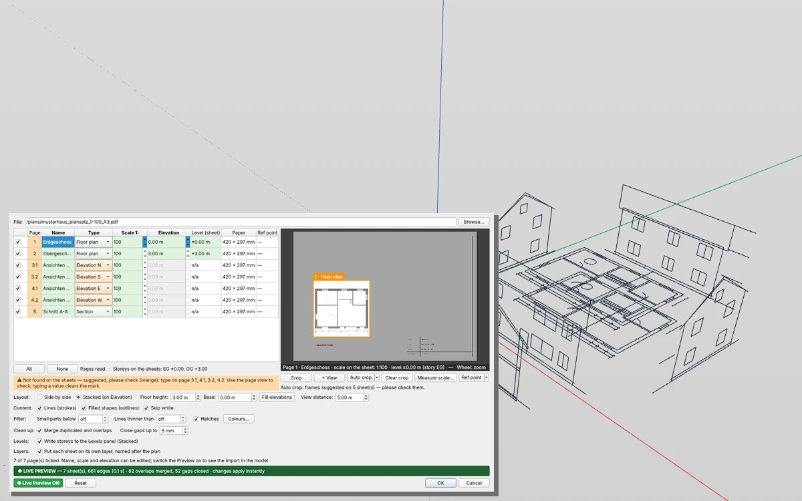

# Plan Import — Grundrisse und ganze Plansätze aus Vektor-PDFs in IngeTrazo

Importiert CAD-Pläne aus einem **Vektor-PDF** (Plot aus ArchiCAD, Revit, AutoCAD, Vectorworks …, kein Scan) als saubere Kanten im richtigen Maßstab — ein Blatt oder einen ganzen Plansatz. Grundrisse werden auf ihre Geschosshöhen gestapelt, Ansichten und Schnitte stehen hochkant drumherum, die Geschosse landen im Levels-Reiter und jedes Blatt auf einer eigenen Ebene.

## Installation
`plan_import_tool_1.2.1.zip` aus dem [neuesten Release](../../releases/latest) laden und in den Plugin-Ordner entpacken (Extensions ▸ Open plugins folder; unter Windows `%APPDATA%\ingetrazo\plugins`). Der Ordner **`plan_import_tool`** muss dort als Unterordner liegen: `plugins\plan_import_tool\__init__.py`. IngeTrazo neu starten → **Extensions ▸ Plan Import…** oder die Werkzeugleiste **Plan Import**. Ab IngeTrazo 0.5.7 · getestet mit IngeTrazo 0.5.8.

## Der Dialog
Mit **Browse…** ein PDF wählen. Jede Seite bekommt eine Zeile; was sich vom Blatt lesen lässt, wird selbst ausgefüllt — **grün** = vom Blatt gelesen, **orange** = Vorschlag (bitte prüfen), **blau** = von dir gemessen/gesetzt. Eintippen löscht die Markierung.

| Spalte | |
|---|---|
| **Page** | Seitennummer; 9.1, 9.2 … = mehrere Zeichnungen auf einem Blatt |
| **Name** | Planname vom Blatt («Erdgeschoss  M 1:100») → Gruppen- und Ebenenname |
| **Type** | Floor plan, Site plan, Elevation N/E/S/W, Section, Flat (other) — eine Prüfroutine liest ihn aus Name oder Inhalt |
| **Scale 1:** | vom Blatt gelesen; sonst **Measure scale…** |
| **Elevation** | Geschosshöhe eines Grundrisses |
| **Level (sheet)** | aus dem Plansatz gelesene Höhen (Geschossmarken in Schnitten/Ansichten, Höhenkoten in Grundrissen) |
| **Ref point** | Referenzpunkt des Blatts |

Daneben das gewählte Blatt als Bild (Mausrad: Zoom · Ziehen: verschieben · Doppelklick: ganzes Blatt). Texte, die wie ein Maßstab aussehen, sind rot markiert.

## Funktionen
- **Content**: **Lines (strokes)**, **Filled shapes (outlines)** (als graue Fläche gezeichnete Wände), **Skip white** (Papiermasken). Bögen und Kreise kommen als Kurven; Texte, Bilder und Verläufe werden übersprungen.
- **Filter**: **Small parts below** N mm auf dem Papier (in Kurven gewandelte Schrift, Maßstriche, Punkte), **Lines thinner than** N mm (Haarlinien), **Hatches** (Schraffuren: gerade Linien in regelmäßigen parallelen Reihen, wie CAD-Programme sie drucken; Treppenstufen liegen weiter auseinander und bleiben), **Colours…** (eine Farbe abhaken = alles in dieser Farbe weglassen).
- **Clean up**: **Merge duplicates and overlaps** (übereinanderliegende Linien werden eine, jeder Endpunkt bleibt ein Punkt), **Close gaps up to** N mm real (lose Linienenden werden an den nächsten Punkt oder die nächste Linie angeschlossen).
- **Layout**: **Side by side** (alle Blätter flach nebeneinander) oder **Stacked (on Elevation)**: Grundrisse übereinander auf ihrer **Elevation**, Lageplan flach, Ansichten und Schnitte **hochkant** um das Gebäude im Abstand **View distance**, nach außen gerichtet, ±0,00 auf z = 0.
- **Floor height** / **Base** / **Fill elevations**: Geschosshöhen aus den gelesenen Höhen, sonst Base + n × Floor height.
- **Measure scale…**: beide Enden einer bekannten Strecke anklicken (fängt an Linienenden), echte Länge eintippen — der Maßstab wird berechnet und auf einen üblichen gerundet.
- **Crop** / **+ View** / **Clear crop**: Rahmen um die Zeichnung ziehen — nur was drin ist, wird importiert. **+ View**: eine weitere Zeichnung auf demselben Blatt wird eine eigene Zeile.
- **Auto crop** (Klick = angezeigtes Blatt, Pfeil ▸ alle angehakten Blätter): erkennt Blattrahmen, Trennlinien und Plankopf und legt um jede Zeichnung einen Rahmen; zwei Schnitte oder zwei Ansichten auf einem Blatt werden zwei Zeilen.
- **Ref point**: auf jedem Blatt DENSELBEN Punkt anklicken (Gebäudeecke oder Achskreuz). Bei Stacked werden die Grundrisse so verschoben, dass er im Ursprung liegt — die Geschosse liegen exakt übereinander, egal wo sie auf dem Papier sitzen; Ansichten und Schnitte stehen so, dass ihr Punkt auf derselben Senkrechten liegt.
- **Levels**: bei Stacked kommen die Geschosse in den Reiter **Levels** (Niveles-Erweiterung) — gestrichelte Höhenlinien in Ansichten und Schnitten.
- **Layers**: jedes Blatt kommt auf eine Ebene mit dem Plannamen («Erdgeschoss», «Ansicht Nord» …).
- **Live Preview**: der Import erscheint im Modell und folgt jeder Änderung; **OK** übernimmt, **Cancel** nimmt zurück. Der ganze Import ist ein Undo-Schritt.
- **Linienarten** (ab 1.2): jedes Blatt merkt sich, wie jede Linie gezeichnet war — Strichstärke, Farbe, Füllung (gepackt, ca. 100–300 kB je Grundriss). Das Plugin **Walls** wählt damit die Wände nach Linienart (z. B. die Wandfüllung) statt nach Geometrie.

## Änderungen
- **1.2.1** — der PDF-Leser füllt IngeTrazos Protokoll nicht mehr mit dem, was er in einem PDF selbst repariert («incorrect startxref pointer» …); getestet mit IngeTrazo 0.5.8.
- **1.2** — **Linienarten**: jedes Blatt merkt sich, wie jede Linie gezeichnet war (Strichstärke, Farbe, Füllung) — für das Plugin [Walls](https://github.com/PESI3D/ingetrazo-walls).
- **1.1** — Filter (Kleinteile, dünne Linien, Schraffuren, Farben), Aufräumen (Doppelte und Überlappungen, Lücken schließen), eigene Werkzeugleiste, Ergebniszeile.
- **1.0** — erste Veröffentlichung: Plansätze aus Vektor-PDFs, Seitenliste, gestapelte Geschosse und aufgestellte Ansichten, Maßstab messen, Zuschneiden und Auto crop, Referenzpunkt, Levels und Ebenen, Live-Vorschau.

## Beispiele
`examples/musterhaus_plansatz_1-100_A3.pdf` — ein erfundener Plansatz (2 Grundrisse, 4 Ansichten auf 2 Blättern, ein Schnitt, Planköpfe): öffnen, **Stacked** wählen, **Auto crop ▸ All ticked sheets**, **Preview** einschalten. Die anderen Dateien sind kleine Testblätter; die `make_*.py`-Skripte (reportlab) erzeugen sie.

## Hinweis
DXF/DWG kommen über den normalen IngeTrazo-Import. Gescannte Pläne (Bilder) haben keine Linien zum Importieren.

PDF-Lesen: [pypdf](https://github.com/py-pdf/pypdf) (BSD-3-Clause), mitgeliefert in `plan_import_tool/_vendor/pypdf` samt Lizenz. Angeregt von PDF-Importern anderer 3D-Programme; mit keinem davon verbunden.

Lizenz GPL-3.0-or-later · Pesi, [pesi3d.de](https://pesi3d.de) — English: [README.md](README.md)
