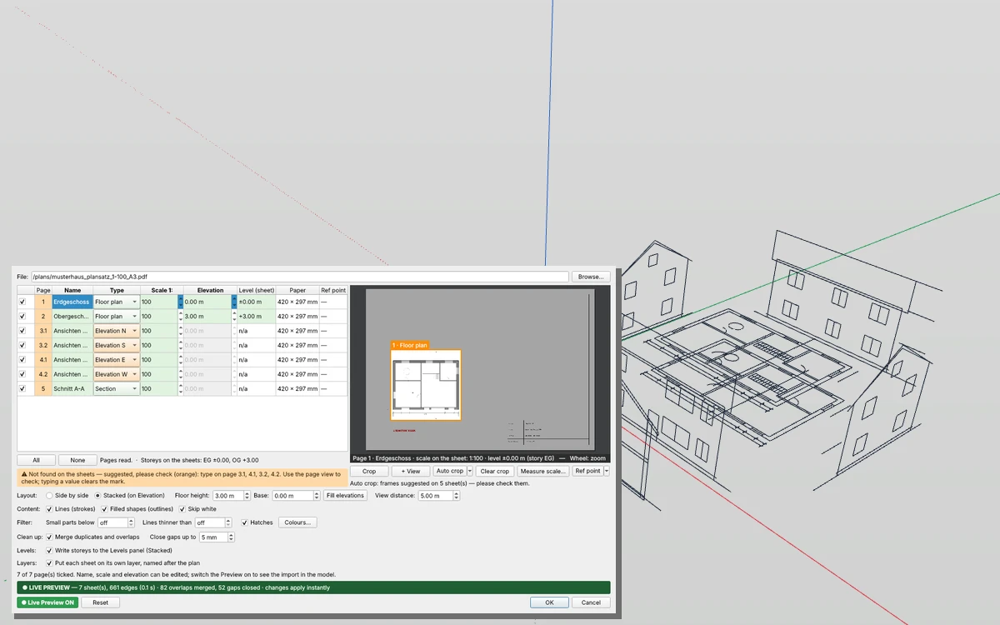

# Plan Import — floor plans and whole plan sets from vector PDFs in IngeTrazo

Imports CAD plans from a **vector PDF** (a plot from ArchiCAD, Revit, AutoCAD, Vectorworks …, not a scan) as clean edges at their real scale — one sheet or a whole plan set. Floor plans are stacked on their storey heights, elevations and sections stand upright around them, the storeys go into the Levels panel and every sheet onto a layer of its own.

## Install
Download `plan_import_tool_1.3.zip` from the [latest release](../../releases/latest) and unpack it into the plugins folder (Extensions ▸ Open plugins folder; on Windows `%APPDATA%\ingetrazo\plugins`). The folder **`plan_import_tool`** must sit there as a sub-folder: `plugins\plan_import_tool\__init__.py`. Restart IngeTrazo → **Extensions ▸ Plan Import…** or the **Plan Import** toolbar. Needs IngeTrazo ≥ 0.5.7 · tested with IngeTrazo 0.6.0.

## The dialog
**Browse…** a PDF. Every page gets a row; what can be read from the sheet is filled in by itself — **green** = read from the sheet, **orange** = suggested (please check), **blue** = measured/set by you. Typing a value clears the mark.

| Column | |
|---|---|
| **Page** | page number; 9.1, 9.2 … = several drawings on one sheet |
| **Name** | drawing name from the sheet («Erdgeschoss  M 1:100») → group and layer name |
| **Type** | Floor plan, Site plan, Elevation N/E/S/W, Section, Flat (other) — a check routine reads it from the name or the content |
| **Scale 1:** | read from the sheet; else **Measure scale…** |
| **Elevation** | storey height of a floor plan |
| **Level (sheet)** | storey levels read from the set (storey markers in sections/elevations, level markers on plans) |
| **Ref point** | the reference point of the sheet |

Beside the list: the selected sheet as a picture (wheel: zoom · drag: pan · double-click: whole sheet). Texts that read like a scale are marked red.

## Features
- **Content**: **Lines (strokes)**, **Filled shapes (outlines)** (walls drawn as grey fills), **Skip white** (paper masks). Arcs and circles come in as curves; texts, images and shadings are skipped.
- **Filter**: **Small parts below** N mm on paper (letters turned into curves, ticks, dots), **Lines thinner than** N mm (hairlines), **Hatches** (straight lines in regular parallel rows, as CAD programs print a hatch; stair treads are wider apart and stay), **Colours…** (untick a colour to leave out everything drawn in it).
- **Clean up**: **Merge duplicates and overlaps** (lines lying on each other become one, every end point stays a vertex), **Close gaps up to** N mm real (loose line ends join the nearest point or line).
- **Layout**: **Side by side** (all sheets flat in a row) or **Stacked (on Elevation)**: floor plans one above the other on their **Elevation**, the site plan flat, elevations and sections **upright** around the building at **View distance**, facing outwards, their ±0,00 line at z = 0.
- **Floor height** / **Base** / **Fill elevations**: storey heights from the levels read on the sheets, else Base + n × Floor height.
- **Measure scale…**: click both ends of a known distance on the sheet (snaps to line ends), type its real length — the scale is computed and rounded to a usual one.
- **Crop** / **+ View** / **Clear crop**: drag a frame round the drawing — only what is inside is imported. **+ View**: another drawing on the same sheet becomes a row of its own.
- **Auto crop** (click = the sheet shown, arrow ▸ all ticked sheets): finds sheet frame, separator lines and title block and puts a frame round every drawing; two sections or two elevations on one sheet become two rows.
- **Ref point**: click the SAME point on every sheet (a building corner or a grid crossing). Stacked: the floor plans are moved so it lies on the origin — the storeys lie exactly one above the other wherever they sit on the paper; elevations and sections stand so that their point is on the same vertical line.
- **Levels**: with Stacked the storeys go into the **Levels** tab (Niveles extension) — dashed level guides in elevations and sections.
- **Layers**: every sheet goes onto a layer named after the plan («Erdgeschoss», «Ansicht Nord» …).
- **Live Preview**: the import shows in the model and follows every change; **OK** keeps it, **Cancel** takes it back. The whole import is one undo step.
- **Line styles** (1.2+): every sheet remembers how each line was drawn — stroke width, colour, fill (packed, about 100–300 kB per floor plan). The **Walls** plugin uses it to pick the walls by line style (the wall fill, say) instead of by geometry.

## Units
The dialog works in the **units of the open document** — set in IngeTrazo under **Window ▸ Units…** (Ctrl+U) or **Window ▸ Preferences… ▸ Units**:
- Length fields show and take the document's length unit and form: m, cm, mm, in, ft, feet-and-inches (`9'10"`) or fractional feet-and-inches (`9'10 1/8"`).
- Type with or without a unit: `25`, `2,5 cm`, `1'2"`, `3/4"`. A number without a unit is in the document's unit (inches in a feet-and-inches document); a value typed in another unit is converted.
- Angles are in the document's angle unit (degrees, radians or gon), areas in its area unit; per-cent fields and counts have no unit. The decimal separator follows the document — `.` and `,` are both accepted when typing.
- Changing the units only changes how values are shown and typed — the model stays exactly as it is. Open the dialog again after changing them.
- On IngeTrazo builds before 0.5.8 the fields are plain numbers in metres.
- **The plans' unit is the working unit.** A metric set (`1:100`, levels `+3,00`) is read in metres, an imperial set (`1/4" = 1'-0"`, levels `+10'-6"`) in feet and inches. **Levels on the plans in** stays on *Automatic (from the plans)*; m, cm, mm, ft and in are only for converting an odd set.
- When the plans are drawn in another system than the document, a tick next to it (on by default) switches the document to the plans' unit on import: ft-in for imperial plans, metres for metric ones.
- **Scale** is the plan's 1:N (an imperial `1/4" = 1'-0"` is 1:48). Paper sizes and the filters *Small parts below* / *Lines thinner than* stay in mm **on the paper**.

## Changelog
- **1.3** — **much faster on large plan sets** (contributed by [@vincentlogarzo](https://github.com/vincentlogarzo), PR #1): sheets are read 10× faster, Close gaps searches an index, the page view draws runs of strokes at once, reading and clean-up run in the background — the window stays usable, Live Preview and option changes no longer freeze IngeTrazo. Import results are unchanged. **Document units**: floor height, base, view distance, elevations, *Close gaps* and *Measure scale* show and take the units of Preferences ▸ Units (paper sizes stay mm on paper); **Imperial plans**: scales «1/4" = 1'-0"», «1" = 20'», levels «+10'-6"», «EL. 12'-0 1/2"» and English storey names (First Floor, Level 2, Basement …) are read. The plans' unit is the working unit: **Levels on the plans in** is *Automatic (from the plans)* — metres for a metric set, feet and inches for an imperial one; m, cm, mm, ft, in only to convert an odd set. When the plans are drawn in another system than the document, a tick switches the document to it on import (ft-in for imperial plans, metres for metric ones). Tested with IngeTrazo 0.6.0.
- **1.2.1** — the PDF reader no longer fills IngeTrazo's log with what it repairs by itself in a PDF («incorrect startxref pointer» …); tested with IngeTrazo 0.5.8.
- **1.2** — **line styles**: every sheet remembers how each line was drawn (stroke width, colour, fill) — for the [Walls](https://github.com/PESI3D/ingetrazo-walls) plugin.
- **1.1** — filters (small parts, thin lines, hatches, colours), clean up (duplicates and overlaps, close gaps), own toolbar, result line.
- **1.0** — first release: plan sets from vector PDFs, page list, stacked storeys and upright views, measure scale, crop and auto crop, reference point, levels and layers, Live Preview.

## Examples
`examples/musterhaus_plansatz_1-100_A3.pdf` — a fictional plan set (2 floor plans, 4 elevations on 2 sheets, a section, title blocks): open it, choose **Stacked**, **Auto crop ▸ All ticked sheets**, switch on the **Preview**. The other files are small test sheets; the `make_*.py` scripts (reportlab) generate them.

## Note
DXF/DWG come in through IngeTrazo's own import. Plans that are scanned images have no lines to import.

PDF reading: [pypdf](https://github.com/py-pdf/pypdf) (BSD-3-Clause), included in `plan_import_tool/_vendor/pypdf` with its licence. Inspired by PDF importers for other 3D programs; not affiliated with any of them.

License GPL-3.0-or-later · Pesi, [pesi3d.de](https://pesi3d.de) — German: [LIESMICH.md](LIESMICH.md)
